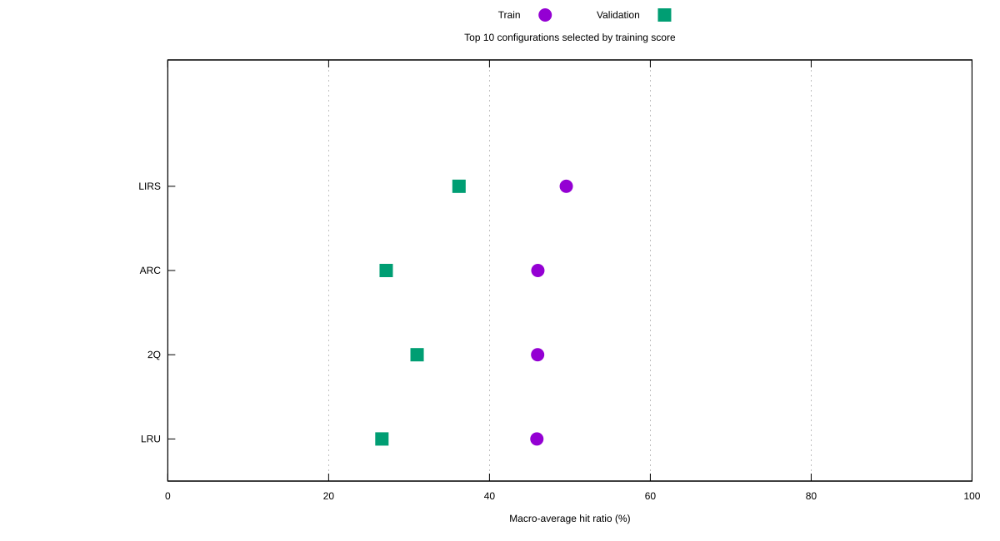
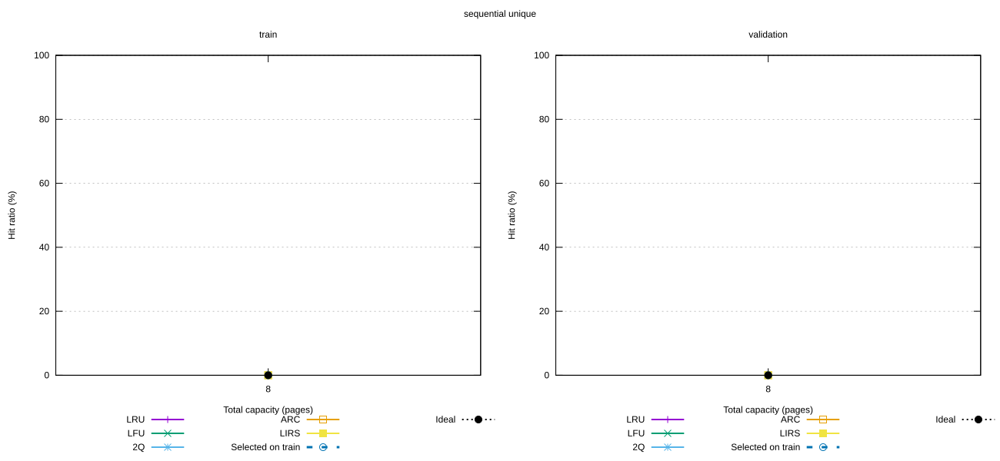
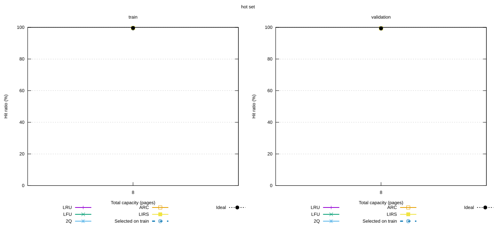
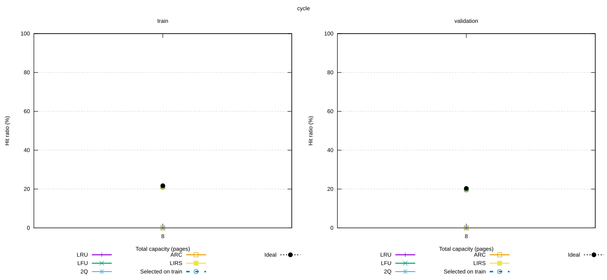
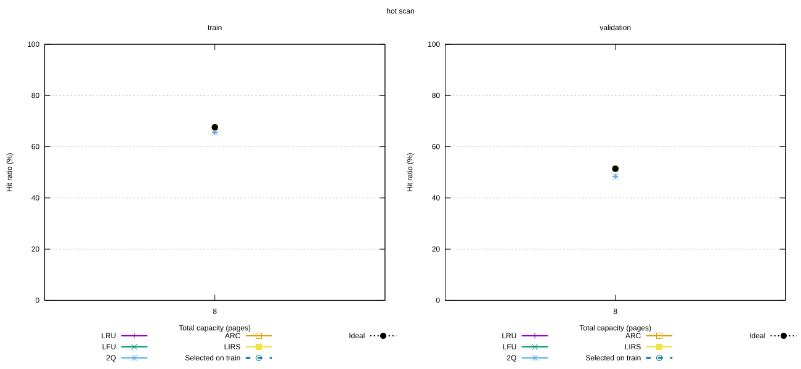
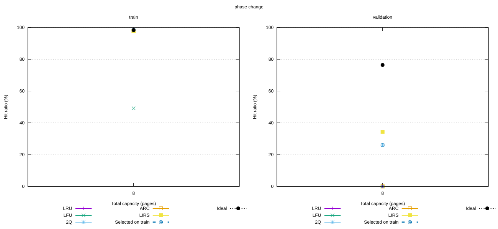
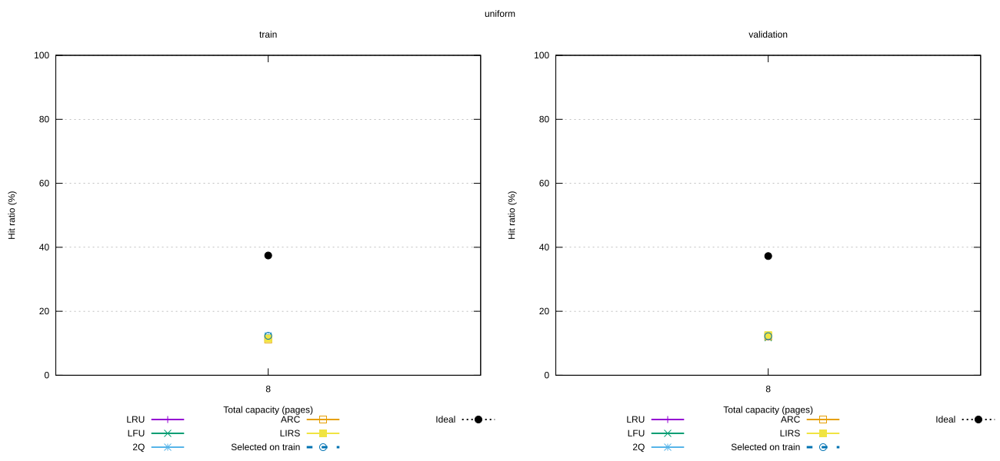

# Исследование политик кеширования

Выполнено **75 прогонов**, 5 конфигураций, 15 последовательностей.
Основная метрика — доля попаданий. Измерения времени выполнения не проводились.

## Условия эксперимента

- Политики: LRU, LFU, 2Q, ARC, LIRS; от одного до трёх уровней, порядок учитывается.
- Каждый прогон начинается с пустых кешей; первоначальные загрузки входят в статистику.
- Сравнивается одинаковая общая ёмкость в страницах. Она делится поровну, остаток получают верхние уровни.
- Одна и та же последовательность подаётся всем кандидатам. Идеальный результат рассчитывается один раз на последовательность и ёмкость.
- Параметры каждого набора и сохранённые входы перечислены в [datasets.csv](datasets.csv).

Train — набор для выбора конфигурации, validation — отдельная проверка выбранного решения. Это подбор конфигураций, а не обучение нейросети.
На validation не перевыбираем победителя. Для случайной нагрузки используются другие seed, для четырёх детерминированных нагрузок — другие параметры. Уникальные ключи остаются контрольным сценарием.
Сначала усредняем seed внутри каждой нагрузки и ёмкости, затем считаем обычное среднее по этим ячейкам. Так случайная нагрузка не получает больший вес из-за числа seed.
При равном результате предпочитаем меньше уровней, затем лексикографически первое название.

## Общий рейтинг по train

Первое место: **LIRS**, train 49,55%, validation 36,21%.
Лучшая одноуровневая конфигурация по train: **LIRS**, validation 36,21%.
Эти оценки — средние по выбранным сценариям и ёмкостям, а не универсальная характеристика алгоритма.

| Конфигурация | Уровни | Train | Validation | Отставание от идеального на validation, п.п. |
|---|---:|---:|---:|---:|
| LIRS | 1 | 49,55% | 36,21% | 11.25 |
| ARC | 1 | 46,02% | 27,16% | 20.30 |
| 2Q | 1 | 45,99% | 31,00% | 16.46 |
| LRU | 1 | 45,89% | 26,62% | 20.83 |
| LFU | 1 | 38,05% | 27,09% | 20.37 |



## Проверка выбранных конфигураций на новых данных

Из 6 пар «нагрузка, ёмкость» на train выбраны многоуровневые решения в 0 случаях.
На validation выбранное решение лучше отдельно выбранного одноуровневого в 0 случаях, хуже в 0; в остальных — равенство.
В таблице «Один уровень» тоже выбран только по train. Δ — разница validation-результатов в процентных пунктах.

| Нагрузка | C | Выбрано на train | Validation | Идеальный | Один уровень | Δ, п.п. |
|---|---:|---|---:|---:|---|---:|
| Циклический рабочий набор | 8 | LIRS | 19,60% | 20,30% | LIRS | +0.00 |
| Горячий набор и сканирование | 8 | ARC | 51,40% | 51,40% | ARC | +0.00 |
| Небольшой горячий набор | 8 | 2Q | 99,40% | 99,40% | 2Q | +0.00 |
| Смена горячего набора | 8 | 2Q | 26,00% | 76,40% | 2Q | +0.00 |
| Новые ключи без повторений | 8 | 2Q | 0,00% | 0,00% | 2Q | +0.00 |
| Равномерные случайные запросы | 8 | 2Q | 12,20% | 37,25% | 2Q | +0.00 |

## Графики по нагрузкам

### Новые ключи без повторений



Левая панель — train, правая — validation. Selected on train — фиксированный выбор для данной нагрузки и ёмкости, сделанный на train.

### Небольшой горячий набор



Левая панель — train, правая — validation. Selected on train — фиксированный выбор для данной нагрузки и ёмкости, сделанный на train.

### Циклический рабочий набор



Левая панель — train, правая — validation. Selected on train — фиксированный выбор для данной нагрузки и ёмкости, сделанный на train.

### Горячий набор и сканирование



Левая панель — train, правая — validation. Selected on train — фиксированный выбор для данной нагрузки и ёмкости, сделанный на train.

### Смена горячего набора



Левая панель — train, правая — validation. Selected on train — фиксированный выбор для данной нагрузки и ёмкости, сделанный на train.

### Равномерные случайные запросы



Левая панель — train, правая — validation. Selected on train — фиксированный выбор для данной нагрузки и ёмкости, сделанный на train.

## Наблюдения по результатам

Одноуровневый LIRS получил максимальный средний train-результат среди перебранных кандидатов; следующий в рейтинге — ARC.
На циклической нагрузке защищённые страницы LIRS сохраняют попадания, тогда как LRU при рабочем наборе больше ёмкости последовательно вытесняет нужные страницы.
На горячем наборе многие политики равны; название выбранного победителя здесь часто определяется правилом разрешения равенства и не доказывает превосходства политики.
Смена фаз показывает риск переноса выбора: при C=8 выбранный на train 2Q имеет 98,40% на train и 26,00% на validation. На validation изменился размер рабочего набора; сравнивать эти два процента как измерение одной и той же нагрузки нельзя.
Малые преимущества на двух validation-seed следует считать наблюдением этого эксперимента: статистическая значимость и универсальное превосходство не установлены.

## Интерпретация и границы выводов

- Уникальные ключи дают нулевую долю попаданий и служат проверкой методики.
- Маленький набор, помещающийся в кеш, после первоначальных загрузок обслуживается без вытеснений.
- Цикл, превышающий ёмкость, проверяет устойчивость к циклическому вытеснению. LIRS может сохранять часть защищённого набора.
- Сканирование проверяет сохранение горячих страниц, смена фаз — способность перестроиться.
- Наш LFU не старит частоты; накопленные частоты старого набора могут мешать после смены фазы.
- В эксклюзивной иерархии найденная ниже L1 страница сразу продвигается. LFU нижних уровней не получает touch и начинает вставки с частоты 1, поэтому там решение часто определяется LRU-порядком равных частот.
- У LIRS HIR-резерв равен max(1, C/100), стек ограничен 2C; у 2Q Kin=max(1,C/4), Kout=max(1,C/2) при C>0. Ghost-история не входит в ёмкость реальных страниц.
- Сравниваются слоты страниц, а не одинаковое число байтов: объём метаданных у политик различается.
- Случайные результаты — средние нескольких seed. sd_hit_ratio в aggregate.csv — выборочное стандартное отклонение между seed, а не доверительный интервал.
- Полный перебор выполнен только внутри заявленного пространства: пять политик, максимум три уровня, равное деление ёмкости. Конфигурации с другим распределением ёмкости и другими нагрузками могут дать другой результат.
- Универсального победителя эти эксперименты не устанавливают. Дополнительные уровни делят ту же ёмкость и не гарантируют улучшения.

## Данные и повторение

- [raw.csv](raw.csv) — все отдельные прогоны.
- [aggregate.csv](aggregate.csv) — средние и стандартные отклонения по seed.
- [ranking.csv](ranking.csv) — общий рейтинг, упорядоченный по train.
- [selected.csv](selected.csv) — выбранные решения и проверка на validation.
- [configurations.csv](configurations.csv) — политики и фактическое распределение ёмкости.
- [manifest.json](manifest.json) — команда, версии и контрольные суммы.

Из корня проекта:

```bash
python3 scripts/run_research.py
```

Алгоритмы основаны на [ARC, Figure 4](https://www.usenix.org/legacy/events/fast03/tech/full_papers/megiddo/megiddo.pdf),
[LIRS, разделы 3 и 5.2](https://xiaodongzhang1911.github.io/Zhang-papers/TR-05-11.pdf)
и [полной версии 2Q](https://www.vldb.org/conf/1994/P439.PDF).
